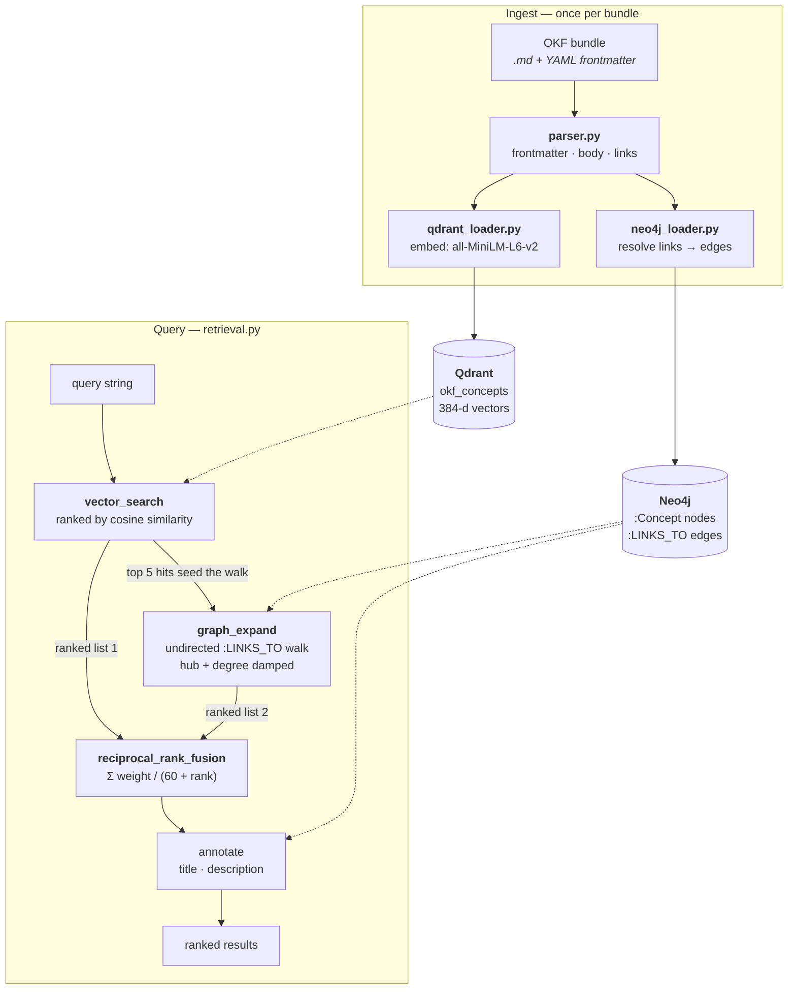

# okf-graphrag

[](https://github.com/devanshif8/okf-graphrag/actions/workflows/tests.yml)
[](LICENSE)

A consumer tool for [OKF (Open Knowledge Format)](https://github.com/GoogleCloudPlatform/knowledge-catalog/tree/main/okf) that ingests OKF bundles into a hybrid retrieval system — vector search (Qdrant) + graph traversal (Neo4j) — so agents can query OKF knowledge instead of just loading files flat into context.

## Why

OKF represents knowledge as markdown files with YAML frontmatter, cross-linked into a graph via normal markdown links. That graph structure is currently only realized visually, in the bundled viewer. `okf-graphrag` realizes it operationally: as a queryable graph combined with semantic search over concept bodies.

## How it works

Ingest runs once per bundle and writes to both stores; query fans out to both
and fuses the two rankings.



The join between the two stores is the **concept id** — `ga4/index.md`, the
path relative to the bundle root. `neo4j_loader.concept_id` mints it, Neo4j
keys its nodes on it, Qdrant carries it in each point's payload, and retrieval
fuses the two rankings by matching on it. Everything else about the two stores
is independent.

## Status

- ✅ **Parser** — extracts frontmatter, body, and links (including anchored links like `file.md#section`) from OKF concept and index files. Handles `index.md` files with no frontmatter as link-only nodes. Tested against the full `knowledge-catalog` repo (129 files) and the `ga4` sample bundle (14/14 parsed cleanly).
- ✅ **Neo4j loader** — loads parsed concepts as `:Concept` nodes and markdown links as `:LINKS_TO` edges. Idempotent (`MERGE`, not `CREATE`), so re-running updates in place, with `--prune` to remove nodes and edges that are no longer on disk. Verified against the `ga4` sample bundle: 14 nodes, 21 relationships.
- ✅ **Qdrant loader** — splits each concept into chunks that fit the embedding
  window, embeds them with `all-MiniLM-L6-v2`, and upserts one point per chunk
  into the `okf_concepts` collection. Idempotent (point ids are derived
  deterministically from the concept id and chunk number), with `--prune` to
  remove points that are no longer on disk. Re-loading embeds only the concepts
  whose content actually changed, and works in bounded batches so peak memory
  does not grow with the corpus. Verified against the `ga4` sample bundle: 14
  concepts, 30 chunks, keyed onto the 14 Neo4j nodes.
- ✅ **Retrieval layer** — hybrid search that fuses Qdrant vector hits with a
  Neo4j `:LINKS_TO` walk using weighted Reciprocal Rank Fusion. Plain Python, no
  LangGraph: the flow is a single linear pass (search → expand → fuse → annotate)
  with no branching or state to manage, so a graph framework would add a
  dependency without buying anything. Worth revisiting if multi-step or
  iterative retrieval lands.
- ✅ **Converter** — `convert_to_okf.py` turns `.pdf`, `.docx`, `.txt` and
  `.html` documents into OKF files that `parser.py` reads unchanged: extracted
  text as the body, provenance (`sources`, `generated`) as frontmatter. Format
  libraries are imported lazily, so only the formats you actually convert need
  their dependency installed.
- ✅ **Linker** — `linker.py` gives a converted bundle the graph it does not
  come with. Converted documents carry no markdown links, so they load as
  isolated nodes and hybrid search quietly degrades to plain vector search.
  The linker extracts keyphrases per document with the bundle's own embedding
  model (KeyBERT-style, MMR-diversified) and links documents that share a
  *discriminative* phrase, writing the edges back into the files as ordinary
  markdown links under a `## Related` heading — so `parser.py` and
  `neo4j_loader.py` handle them unchanged. Built to run on a corpus rather than
  a sample bundle: candidates that cannot form an edge are discarded before
  being embedded, the surviving vocabulary is embedded once rather than once per
  holder, the MMR matrix is capped, and edge derivation costs the pairs that
  actually share a phrase instead of every pair that exists.
- ✅ **Web UI** — `webui.py` serves the hybrid search as a page: one search
  box, the fusion weights as sliders, results re-ranked live. A FastAPI app
  served by uvicorn, with the embedding model and both store clients opened
  once at startup rather than per query. Every request is logged as one JSON
  object with a request id and a duration, `/metrics` exposes counters and a
  latency histogram in Prometheus format, and an optional shared token guards
  everything but the liveness probe.
- ✅ **Evaluation harness** — `eval/` scores retrieval against a ground-truth
  query set (Recall@k, MRR, nDCG@k) for vector, graph and hybrid separately, so
  the graph half's contribution is measurable rather than assumed. A committed
  fixture corpus and query set run the same measurement in CI as a quality
  gate.

## Setup

```bash
pip install -r requirements.txt
```

That is `pyyaml`, `neo4j`, `python-dotenv`, `qdrant-client`,
`sentence-transformers` and `numpy`, plus `fastapi` and `uvicorn` for the web
UI. Python 3.10 or newer.

The converter needs three more — `pypdf` for `.pdf`, `python-docx` for `.docx`
and `beautifulsoup4` for `.html`:

```bash
pip install pypdf python-docx beautifulsoup4
```

`convert_to_okf.py` imports them lazily and only for the format you actually
convert, so ingest and search run without any of them. They are kept out of
`requirements.txt` for that reason — nothing on the load-and-search path uses
them, so the container image does not ship them either. `requirements-dev.txt`
installs them along with everything else.

The Neo4j loader reads its connection details from environment variables, loaded
from a `.env` file in the project root (git-ignored). Copy the template and fill
it in:

```bash
cp .env.example .env
```

```
NEO4J_URI=bolt://localhost:7687
NEO4J_USER=neo4j
NEO4J_PASSWORD=your-password
```

Qdrant needs no credentials locally; set `QDRANT_URL` in the same file to point
at a server other than `http://localhost:6333`.

The Qdrant loader reads `QDRANT_URL`, defaulting to `http://localhost:6333` if
it isn't set. It needs no credentials. On first run it downloads the
`all-MiniLM-L6-v2` embedding model from the Hugging Face Hub and creates the
`okf_concepts` collection at that model's dimension.

## Usage

Parse a single file:
```bash
python parser.py path/to/concept.md
```

Parse an entire bundle:
```bash
python parser.py --bundle path/to/bundle_dir
```

Load a bundle into Neo4j:
```bash
python neo4j_loader.py path/to/bundle_dir
```

It prints how many nodes and relationships were merged, e.g.
`14 nodes merged, 21 relationships merged`. Paths are relative to the current
working directory — from the project root, the sample bundle is
`knowledge-catalog/okf/bundles/ga4`.

Re-running is safe: nodes are keyed on a bundle-relative id (`ga4/index.md`), so
a second load updates the same nodes rather than duplicating them — from any
working directory, relative path or absolute.

### Pruning deleted concepts

Loading only ever `MERGE`s, so it adds and updates but never removes. Delete or
rename a concept file, or drop a link out of one, and the node or edge it wrote
last time stays in the database — invisibly, and it keeps surfacing in search.
Pass `--prune` to reconcile the stored bundle with the parsed one:

```bash
python neo4j_loader.py path/to/bundle_dir --prune
python qdrant_loader.py path/to/bundle_dir --prune
```

Each prints what it removed on top of the usual load line, e.g.
`1 stale nodes deleted, 2 stale relationships deleted`. Deletion is scoped by
the bundle's id prefix (`ga4/`), so other bundles sharing the database or the
collection are untouched. Stale edges are removed before stale nodes, so an edge
that vanishes along with its node is still reported rather than disappearing
silently.

It is off by default because it is the one destructive operation here. As a
guard against the obvious way to lose a bundle, a prune whose parse produced no
concepts at all — a mistyped or empty bundle path — is refused rather than
deleting everything the prefix matches.

Inspect the result in Neo4j:
```cypher
MATCH (a:Concept)-[:LINKS_TO]->(b:Concept) RETURN a.path, b.path
```

Load the same bundle into Qdrant:
```bash
python qdrant_loader.py path/to/bundle_dir
```

It prints what it embedded, e.g.
`14 of 14 concepts embedded as 30 chunks and upserted into 'okf_concepts'`.

Each concept is split into ~160-word chunks and stored as one point per chunk,
because the embedding model stops reading at 256 word-pieces — roughly 180
words. Without chunking a long document is indexed by its opening paragraph and
the rest is silently unsearchable. Chunk 0 is keyed on the bare concept id, so a
document short enough to be a single chunk keeps the point id it always had.

Re-running is safe, and cheap. Each concept carries a digest of its chunks and
its payload, so a second load re-embeds only what changed:

```
1 of 14 concepts embedded as 3 chunks and upserted into 'okf_concepts', 13 unchanged
```

The digest covers the payload as well as the text, so correcting a title with
the body untouched still rewrites the stored points. It cannot see changes to
the model, the chunk width or the embedding text — pass `--force` after any of
those to re-embed everything. `--prune` drops the points whose concept file is
gone, and any chunks left stranded past the end of a document that was edited
shorter.

Each point's `path` payload field is the same bundle-relative id the Neo4j nodes
are keyed on, so a vector hit joins straight onto the graph:
```cypher
MATCH (c:Concept {path: $path_from_qdrant})-[:LINKS_TO]->(n) RETURN n.path
```

### Hybrid search

With a bundle loaded into both stores, query it:
```bash
python retrieval.py "how many users made a purchase"
```

```
1. Acquired Users Metric
   ga4/references/metrics/acquired_users.md
   rrf 0.0241  (graph #1, vector #3)
   Builds an audience of users acquired via a specific Source, Medium, and Campaign name.

2. Purchasers Audience Metric
   ga4/references/metrics/purchasers.md
   rrf 0.0239  (graph #7, vector #1)
   Computes the count or list of users who have completed a purchase or in-app purchase.
```

Each result shows its fused score and the rank it held in each list, so you can
see which signal put it there. Flags: `--top-k` (default 10),
`--vector-weight` / `--graph-weight` to rebalance the fusion (defaults 1.0 and
0.5), `--include-index` to keep hub nodes in the graph list, and
`--degree-damping` to tune how hard well-connected nodes are penalised
(default 0.5, `0` disables) — see the design notes on hub damping below.

`--top-k` sets how many results are *returned*, not how deep the search goes:
at least `MIN_CANDIDATES` (10) vector hits are always retrieved and fused, so
narrowing the output can't change the order of what's left.

The three stages are importable on their own:
```python
from retrieval import vector_search, graph_expand, hybrid_search

vector_search("purchase events", top_k=5)   # [{"id": ..., "score": ...}, ...]
graph_expand(["ga4/index.md"], hops=2)      # [{"id", "distance", "degree", "score"}, ...]
hybrid_search("purchase events")            # fused, annotated with title/description
```

### Answering questions

`answer.py` puts an LLM on top of hybrid search. It gets the top passages,
numbers them, and asks an OpenAI model to answer **only** from them, citing
each claim as `[n]`. It needs `OPENAI_API_KEY` in `.env`. `OPENAI_MODEL` is
optional and defaults to `gpt-4o-mini`.
```bash
python answer.py "Something in the dough is clearly alive - what's it doing in there?"
```

When the passages don't answer the question, the model replies with a fixed
token and the CLI prints "The library doesn't answer that." instead of an
answer. This matters for a pre-1920 library: a question about jet lag still
retrieves the nearest chapter on travel. Citations are checked afterwards.
A `[n]` that names no passage is removed, and an answer that cites nothing is
flagged. `--top-k` sets how many passages the model sees (default 6).

The generation step never changes ranking. `hybrid_search` runs with its
defaults, so the retrieval numbers below still describe the system the
answers come from.

### Converting your own documents

A bundle does not have to be written by hand. `convert_to_okf.py` turns a
directory of `.pdf`, `.docx`, `.txt` and `.html` files into OKF markdown:

```bash
python convert_to_okf.py path/to/documents --output-dir path/to/bundle_dir
```

The input can be a single document instead of a directory.

It recurses into subdirectories and reports each outcome — converted, skipped
(unsupported extension), or failed (unreadable, or no extractable text) — and
one bad document never aborts the batch. Each output file gets a slugified
name, a title taken from the document's own metadata where it has one and the
filename otherwise, a `description` summarised from the opening prose, and a
`sources` entry recording the original as a `file://` URL with its format,
author and page count. `status` is `draft`: nothing machine-converted has been
checked by a human yet.

Conversion needs the library for the format you are converting — `pypdf`,
`python-docx`, `beautifulsoup4` — but imports it lazily, so `.txt` and `.html`
work with nothing extra installed.

### Linking a converted bundle

A converted bundle has no links, because a PDF has no notion of an OKF concept
path. Loaded as-is it is a pile of isolated nodes: `graph_expand` finds nothing
to walk and `hybrid_search` collapses into plain vector search. `linker.py`
derives the missing edges:

```bash
python linker.py path/to/bundle_dir
```

It extracts up to ten keyphrases per document — candidate n-grams ranked by
similarity to the document's own embedding, using the same `all-MiniLM-L6-v2`
the bundle is indexed with, with MMR so the list is not five rewordings of one
idea — then links two documents when they share a phrase that is
*discriminative*: held by at least two documents but not by more than half of
them, since a phrase every document carries separates nothing.

Keyphrase extraction runs over the corpus, not one document at a time. A first
pass enumerates every document's candidate phrases with no model at all and
counts how many documents each appears in; a phrase that occurs in exactly one
document cannot produce an edge however good it is, and in real prose most
n-grams occur exactly once, so those are discarded before anything is embedded.
The second pass embeds what survives once per *distinct* phrase across the whole
corpus rather than once per document holding it. Measured on the `ga4` bundle
and on the regression fixture, that is 8× fewer texts embedded, and the factor
grows with the corpus as more of the vocabulary is shared. `--min-df 1` restores
the old behaviour of embedding every candidate.

It does change which phrases are selected, deliberately: with singletons gone,
more of each document's ten slots go to phrases that can actually link
something, which is what the keyphrases are for.

The document vector each phrase is ranked against is the mean of the document's
chunk embeddings, not `encode(body)` — which truncates at 256 word-pieces, so on
anything longer than about 180 words it described the opening paragraph and
every keyphrase was ranked for relevance to page one. It reuses the splitter the
Qdrant loader indexes with, so both stores mean the same thing by "this
document".

Edges are written into the files themselves, under a `## Related` heading, with
the shared phrase as the link text:

```markdown
## Related

- [security training](security-training.md)
```

So each edge states the reason it exists, the files stay readable, and nothing
downstream changes — `parser.py` already extracts markdown links and
`neo4j_loader.py` already resolves them into `:LINKS_TO` edges. The section is
rewritten in place on every run, so re-linking updates the edges instead of
stacking a second copy.

Flags: `--top-n` (keyphrases per document, default 10), `--max-links` (most
documents linked from any one, default 5 — without a cap a single-subject
corpus becomes a clique, which carries no more information than no edges at
all), `--max-df-ratio` (default 0.5), `--max-df-absolute` (default 200),
`--min-df` (default 2), and `--dry-run` to print the edges without touching the
files. Every edge is printed
as `doc.md --[shared phrase]--> other.md`, so a dry run shows exactly what the
graph would become.

**Scaling.** Edge derivation costs the number of document pairs that actually
share a phrase, not the number of pairs that exist. It used to walk every
document against every other to collect each one's partners — fine for the
fourteen files of a sample bundle, a hundred million dictionary lookups at ten
thousand. Measured on a sparse corpus, the rewrite is 5× faster at 500
documents and 13-30× at 2000-4000, and the gap widens with the corpus because
the old pass was quadratic and this one is not.

`--max-df-absolute` is the other half of that. `--max-df-ratio` is a
proportion, so it grows with the corpus and still admits a phrase held by
half of fifty thousand documents — 625 million pairs to enumerate for one
phrase. A constant ceiling makes the pass linear in both the corpus and the
ceiling (`10·N·df` pairs overall), which is why it can afford to be generous.
It defaults to 200 rather than something tighter because the cap is not free: a
single-subject corpus has a small vocabulary and correspondingly high document
frequency, and on 2000 documents sharing 200 phrases a ceiling of 50 yields
4590 edges where 200 yields 10000. That difference is signal being dropped, not
noise being filtered. Raise it if a large single-subject bundle comes out
sparser than it should.

Run it before loading: link, then `neo4j_loader.py`, then `qdrant_loader.py`.

### The browser UI

The fusion knobs the CLI exposes as flags are easier to feel as sliders:

```bash
python webui.py
```

That serves the search page on `http://127.0.0.1:8000` and opens a browser at
it. One search box, sliders for `top_k`, the vector and graph weights and the
degree damping, and results that re-rank as you move them — the same
`hybrid_search` the CLI calls, so the two agree by construction. Each result
shows its fused score and its rank in each list.

It is a FastAPI app under uvicorn and one static page: a route for the page,
one for `/api/search`, and a `/healthz` liveness probe. The stdlib's
`http.server`, which this used to be, documents itself as unsuitable for
production — no request timeouts, no body-size limits, no graceful shutdown,
and a thread per connection with no ceiling — so it was replaced rather than
hardened.

The embedding model and both store clients are opened once in the lifespan hook
and closed on shutdown, so the first search after startup is as fast as the
rest and no query pays for connection setup. Failures come back as the same
guidance the terminal gives ("could not reach Neo4j at … - is the database
running?") rather than a stack trace: an unreachable store or an unloaded
collection is a `503`, since it is the caller's to fix, while anything
unanticipated is a `500` carrying an incident id that matches a logged
traceback the client never sees.

Every request is logged as a single JSON object carrying a request id, the
route, the status and the duration in milliseconds, and the same request id
comes back in the `X-Request-Id` header — so a user reporting a slow or failed
search can quote the exact line. `--text-logs` switches back to prose for
reading over the shoulder of a local run.

`/metrics` serves Prometheus text: `okf_requests_total` by route and status,
an `okf_request_duration_seconds` histogram, search and search-error counters,
and whether the model is resident. It is hand-rolled rather than pulled from
`prometheus_client`, which would be most of a megabyte for a dozen lines of
output format.

Authentication is off by default and on as soon as `OKF_API_TOKEN` is set, at
which point every route but `/healthz` needs the token — as an
`Authorization: Bearer` header, an `X-API-Key` header, or a `token` query
parameter. Liveness stays open because a container healthcheck usually cannot
carry a token and it reveals nothing; `/metrics` does not, because request
counts and latencies describe usage. The browser gets the token in the URL
(`http://127.0.0.1:8000/?token=...`) since a top-level navigation cannot set a
header, and the page forwards it on each search.

Flags: `--host` and `--port` to move it, `--no-browser` to leave the browser
alone, `--text-logs`, and `--insecure`. It binds `127.0.0.1` by default.
Binding anything else without `OKF_API_TOKEN` set is **refused** rather than
warned about — an unauthenticated search API reachable from the network is the
kind of mistake that is only noticed later — and `--insecure` is the override
for a network you actually trust.

**Ask** (next to Search) also writes a cited answer from the retrieved passages
and shows it above the results. It uses `/api/answer`, which needs
`OPENAI_API_KEY`; see *Answering questions* above. The answer does its own
retrieval at the default settings, so the tuning sliders don't change it.

## Measuring accuracy

`eval/` scores retrieval against a ground-truth query set, so "is it accurate"
has a number rather than an impression. The pipeline, from a directory of
full-text books to a table:

```bash
python eval/split_books.py books/ --output-dir chapters/
python convert_to_okf.py chapters/ --output-dir shelf/
python linker.py shelf/
python neo4j_loader.py shelf/ && python qdrant_loader.py shelf/
python eval/make_queries.py shelf/ --output eval/queries.jsonl
python eval/evaluate.py eval/queries.jsonl
```

**Split first.** `qdrant_loader` writes one vector per file and
`all-MiniLM-L6-v2` truncates at 256 word-pieces — about 180 words. A whole book
in one file is indexed by its first page and the rest is silently discarded, so
a score measured that way would be measuring a missing chunking layer, not the
retrieval design. `eval/split_books.py` splits on chapter headings (falling back
to fixed-size chunks when a book has none), strips the Project Gutenberg licence
wrapper — boilerplate shared by every book would otherwise give the linker a
corpus-wide keyphrase to link a clique on — and prefixes each output filename
with the book, since `convert_to_okf.py` flattens the tree and would otherwise
reduce every book's first chapter to `chapter-i.md`, `chapter-i-2.md`, and so on.

**Ground truth.** `eval/make_queries.py` builds a known-item set: sample a
passage out of a document, use it as the query, and that document is the one
correct answer. Weaker than human relevance judgements — a real user's phrasing
is not lifted from the text — but unbiased with respect to the retriever, free
of labelling, and as large as the corpus. Each query records the `region` it
came from, `head` (inside the embedding window) or `tail` (past it), and
`evaluate.py` breaks the metrics down by it: a tail query's answer was never
embedded and *cannot* be retrieved, so the split separates truncation loss from
ranking loss instead of blaming the ranker for both.

**The comparison.** `eval/evaluate.py` reports Recall@{1,5,10}, MRR and
nDCG@{1,5,10} for three retrievers over the same vector call — `vector` alone,
`graph` alone, and `hybrid` — plus a per-query win/loss/tie count, since a mean
can improve because one query improved a lot. `--sweep 0 0.25 0.5 1 2` scores a
fusion per graph weight in one pass, reusing the single vector search and graph
walk across all of them.

### The quality gate

Retrieval quality has no compiler. A change to chunk width, fusion weights,
degree damping or the embedding text can leave all 282 offline tests green while
quietly making search worse, and nobody finds out until someone notices bad
results months later. `tests/integration/test_eval_regression.py` is what turns
that silent drift into a failed build.

It runs the same harness over a committed fixture corpus —
`eval/regression/bundle`, eleven hand-written OKF files across brewing, baking
and microbiology — and a committed query set of fifteen needs written the way a
person would ask them, then asserts floors:

| run | measured | floor |
|---|---|---|
| vector MRR | 0.913 | 0.80 |
| hybrid MRR | 0.883 | 0.75 |
| hybrid recall@5 | 1.000 | 0.90 |
| graph MRR | 0.632 | 0.45 |

The floors sit well below the measurements on purpose: a gate that fails on
noise gets disabled, so the margin has to absorb an embedding-model point
release without absorbing a real regression. The graph floor matters most —
break the linker, the edge resolution or the walk and vector search alone still
returns something plausible, so that is the number that notices.

The corpus is small because CI has to finish in minutes and a floor only means
anything if the input is byte-identical every run. It is **not** an accuracy
benchmark: eleven documents cannot tell you how good retrieval is, only whether
it got worse.

One test in it is a **chunking canary**. `brewing/yeast-pitching.md` puts its
diacetyl material past word 160, so three queries in the set can only be
answered if that document was split into more than one vector. Verified as a
negative control: with chunking disabled, two of those three do not retrieve the
document *at all* in the top 5; with it, both come back at rank 1. No other
assertion in the suite would catch a chunking regression.

CI runs it as its own step, so the log distinguishes "retrieval got worse" from
"the plumbing broke".

Two things the table cannot tell you, both structural:

- The `graph` row is **not an independent baseline**. `graph_expand` needs seed
  ids and the seeds are the top vector hits, so that row means "the
  neighbourhood of what vector search found", and it can only score at all when
  the answer sits next to a vector hit.
- On a **known-item** query the correct document is usually the seed itself, and
  `graph_expand` excludes each seed from its own neighbourhood — so the graph
  list can rarely rank the answer it already holds, and fusion has almost no
  room to beat plain vector search. Measured on the `ga4` bundle, hybrid scores
  *below* vector (MRR 0.561 vs 0.742) for exactly this reason. Known-item
  answers "is the corpus retrievable at all"; judging what the graph half
  contributes needs queries whose answer is a document the vector list missed,
  which means either human-written queries or a benchmark with real `qrels`.

### The library experiment

Those two paragraphs are why the known-item number is not the headline. To judge
the graph half, the corpus was rebuilt as **a library and a librarian**: ask for
what you need in your own words, see whether the right books come back.

`eval/library.csv` lists 32 Project Gutenberg books, four in each of eight
domains, and `eval/fetch_library.py` downloads them. Two pairs of domains are
**adjacent on purpose** — cookery/chemistry and medicine/natural history —
because separating cookery from astronomy is trivial and a high score at it
means nothing. The shelf is 2,405 chapter documents and 36,628 chunks.

It is not a balanced corpus, and the scores below are read against chance for
that reason: eleven books have no detectable chapter headings and fell back to
600-word chunks, so cookery contributes 822 documents and medicine 126.

```bash
python eval/fetch_library.py --output-dir library/books
python eval/split_books.py library/books --output-dir library/chapters
python convert_to_okf.py library/chapters --output-dir library/shelf
python linker.py library/shelf
python neo4j_loader.py library/shelf && python qdrant_loader.py library/shelf
```

#### Is the graph signal at all?

The cheapest question, and the one worth asking before writing a single query:
every book carries a domain label, so every `:LINKS_TO` edge can be asked
whether it stayed on its own shelf. If that rate is near chance, fusion has
nothing to harvest and hybrid search is vector search wearing a hat.

```bash
python eval/edge_coherence.py library/shelf --output library/edge_coherence.json
```

| | rate | chance | lift |
|---|---|---|---|
| same domain | 0.907 | 0.200 | 4.5x |
| same book | 0.749 | 0.076 | 9.8x |
| **cross-book, same domain** | **0.629** | **0.155** | **4.1x** |

**Read the third row, not the first.** Three quarters of the edges join two
chapters of the same book, where staying in-domain is guaranteed by construction
and measures nothing. Only an edge that leaves its book is the linker making a
claim about two documents it had no a-priori reason to connect, and there the
rate is 0.629 — real signal, but a third of it is wrong. Chance is resampled per
edge from its source rather than over all pairs, because the domains are not the
same size and a linker firing mostly inside the largest one would otherwise look
coherent for free.

The per-source breakdown is the useful part, and it predicts the rest of the
results:

| source domain | cross-book edges | same-domain | chance |
|---|---|---|---|
| cookery | 1302 | 0.821 | 0.263 |
| astronomy | 278 | 0.709 | 0.051 |
| law | 365 | 0.699 | 0.145 |
| chemistry | 213 | 0.376 | 0.056 |
| travel | 330 | 0.370 | 0.067 |
| medicine | 220 | 0.327 | 0.036 |
| philosophy | 105 | 0.314 | 0.045 |
| natural-history | 175 | 0.297 | 0.035 |

Cookery supplies 44% of all cross-book edges and is the only domain that links
well; five domains sit at 0.30-0.38. The leaks land where they were designed to
— chemistry↔cookery is the largest single pair at 183 edges — which is the
adjacent-pair design working as a test rather than the linker failing at random.

#### A floor: does the right shelf come back?

```bash
python eval/make_domain_queries.py library/shelf --output library/domain_queries.jsonl
python eval/evaluate.py library/domain_queries.jsonl --group-by domain
```

25 passage queries per domain, scored with **precision@k** rather than recall —
recall over hundreds of same-domain documents is meaningless — and with the
query's own book excluded, so only *other* books on the shelf can count.

| run | precision@10 | MRR |
|---|---|---|
| vector | 0.487 | 0.643 |
| graph | 0.388 | 0.555 |
| hybrid | **0.512** | 0.628 |
| chance | 0.076 | |

Hybrid edges vector on precision and **loses to it on MRR** (25 queries better,
60 worse): fusion pulls more of the right shelf into the top ten while pushing
the single best hit down. Read this table as "nothing is grossly broken", not as
accuracy — these are still passage queries lifted from the text. Weakest domains
are natural history (~0.28) and medicine and chemistry (~0.35), the same ones
that linked worst above. At n=25 per domain, differences of ~0.1 between domains
are noise.

#### The real test: 41 hand-written needs

`eval/needs.csv` holds 41 needs written by hand, phrased as a person would ask
them, nine of them cross-cutting. Relevance is the whole shelf the need belongs
to.

```bash
python eval/make_need_queries.py library/shelf --output eval/need_queries.jsonl \
    --probes eval/probe_queries.jsonl
python eval/evaluate.py eval/need_queries.jsonl --group-by kind --output library/need_results.json
```

| run | precision@10 | 95% CI |
|---|---|---|
| vector | 0.785 | [0.707, 0.856] |
| graph | 0.749 | [0.673, 0.822] |
| hybrid | **0.832** | **[0.759, 0.895]** |
| chance | 0.160 | |

hybrid − vector = **+0.046**, paired 95% CI **[+0.020, +0.078]**, sign test
**p = 0.007** (13 queries better, 2 worse, 26 tied). This is the first
measurement in which the graph half is shown to help rather than to cost.

**What produced that result was fixing the queries, not the system.** The same
pipeline, unchanged, scored +0.012 with 3 better and 4 worse — indistinguishable
from noise — on the first drafts of the same needs. Those drafts were written in
the vocabulary of their own answers, which is precisely the condition under
which a vector search needs no help. Rewriting them to strip the answer's
keywords ("Something in the dough is clearly alive — what's it doing in there?"
rather than "What does yeast do in bread dough?") is what let the effect appear.
The measurement was hiding it. Any query set written by whoever knows the corpus
has this bias by default.

Error bars are built into `eval/evaluate.py`: a percentile bootstrap over
**queries**, since the queries are the sample, paired for the difference, plus an
exact sign test with ties excluded. It prints a sentence saying so when an
interval straddles zero. Writing it found a real bug — the headline metric was
selected through a variable shadowed by a loop, so the tool had been silently
reporting nDCG@10 under a precision heading.

Two things the +0.046 does **not** mean:

- **It is shelf-level.** "Precision 0.832" means the chapters returned were on
  the right shelf, not that they answer the question. Chapter-level judgements
  are the remaining ceiling — see below.
- **It is one query set of 41.** The CI is a statement about that sample size.

#### Probes: needs this library cannot answer

The first draft of the travel needs was entirely modern logistics — passports,
jet lag, layovers — none of which exists in a pre-1920 library. That failure was
kept rather than discarded: `eval/needs.csv` marks 8 needs as probes, where the
honest answer is *nothing*.

`--probes` above writes them to their own file, and `make_need_queries.py`
refuses to run without it once any need is labelled `none`, so a probe can never
be scored for precision by accident.

```bash
python eval/judge.py pool library/shelf eval/probe_queries.jsonl \
    --output library/probe_judgements.csv
python eval/mark.py library/probe_judgements.csv
python eval/judge.py probes library/probe_judgements.csv --queries eval/probe_queries.jsonl
```

Every retriever always returns its k results, so the probe set measures what a
reader makes of them. Corpus-period coverage is the recurring trap in writing
needs for a historical corpus, and it is worth checking every new need against.

#### Hand judging

```bash
python eval/judge.py pool library/shelf eval/need_queries.jsonl --output library/judgements.csv
python eval/mark.py library/judgements.csv --needs 15          # one row per screen
python eval/judge.py build library/judgements.csv \
    --queries eval/need_queries.jsonl --output eval/judged_queries.jsonl --partial
python eval/evaluate.py eval/judged_queries.jsonl --group-by kind
```

`pool` runs all three retrievers and writes the union of their top ten as one row
per (need, chapter) with a snippet: 738 rows. Three properties keep it honest —
the row does not say which retriever found the chapter or at what rank, the rows
are shuffled within each need, and the domain label is absent, because a judge
who can see that hybrid ranked something first would mark it relevant more often
and that bias would land squarely on the comparison the exercise exists to make.
`eval/mark.py` presents one row at a time in the terminal, saves after every
keystroke, and leaves a skipped row blank rather than assuming it irrelevant.
`build --partial` then scores a half-finished sheet, dropping needs nothing was
marked for — an unjudged need measures the judge running out of afternoon, not
the retriever.

Pooling has a cost worth stating: only chapters some retriever returned are ever
judged, and everything unjudged is scored as irrelevant. That is fair between
these three runs, since all three fed the pool, but a fourth retriever scored
against the same file later would be punished for finding good chapters these
three missed. There is also a **single judge** and so no inter-rater agreement
figure.

## Design notes

- `index.md` files without frontmatter are treated as link-only structural nodes (`is_index: true`) rather than skipped, since they carry real graph edges.
- Link extraction matches `.md` targets, including an optional trailing anchor (`file.md#section`) — the anchor is preserved in the returned target, not stripped.
- External links (non-`.md`) are intentionally excluded from the concept graph.
- Each `:Concept` node is keyed on a **bundle-relative id** — the path relative to
  the bundle root, prefixed with the bundle directory name and normalized to
  forward slashes (`ga4/references/metrics/purchasers.md`). This id is
  independent of the working directory the loader ran from and of the host OS,
  so re-runs update nodes in place instead of duplicating them, and the same
  bundle keys identically on any machine. Downstream stores (Qdrant) should use
  this id to reference graph nodes.
- A uniqueness constraint on `:Concept(path)` is created before the first write
  of every load. It enforces the one-node-per-concept-id invariant the
  Qdrant↔Neo4j join rests on, and — because a constraint carries an index —
  keeps `MERGE` an index lookup instead of a full label scan, which is what
  makes loading linear rather than quadratic in the size of the bundle.
- The on-disk location is kept as a separate `source_path` property. Nothing
  keys on it, so it can safely differ between machines.
- The loader stores every frontmatter field as an additional property. Values Neo4j can't store natively (nested
  dicts, mixed-type lists) are JSON-serialized; a frontmatter key named `path`
  is dropped so it can't overwrite the node id.
- Link targets are written relative to the linking file, so the loader resolves
  each one against its source directory and strips any `#anchor` before matching.
  Edges are only created when the target file is part of the same batch —
  dangling links are silently skipped rather than creating empty nodes.
- `bundle_edges` derives that edge set from the parsed concepts alone, so the
  load and the prune agree on what the bundle currently implies by construction
  rather than by two implementations happening to match.
- Bundle names come from the bundle directory's own name, so two bundles loaded
  into the same database stay distinct even though both contain `index.md`.
  Loading two *different* directories that share a basename would collide.
- Qdrant point ids must be an unsigned integer or a UUID, so they can't be the
  concept id itself. Each id is a UUIDv5 of the concept id under a fixed
  namespace — deterministic, so re-runs upsert rather than duplicate — and the
  readable id is kept in the payload as `path`.
- The embedded text is the frontmatter `description`, when present, followed by
  the body, so the one-line summary is weighted alongside the full content.
- **Chunking.** A concept is split into ~160-word chunks with a 32-word overlap
  and stored as one point per chunk. 160 rather than the model's ~195-word
  ceiling leaves headroom for text that tokenizes worse than average, since a
  chunk that overflows is not an error but silently discarded content. Splits
  prefer paragraph boundaries, then sentence boundaries, then a hard word
  slice — the boundaries the author already drew keep a chunk about one thing.
  Hard slices are cut narrower than the chunk width so the overlap still fits
  behind them; at a natural boundary the overlap is dropped rather than
  exceeding the window.
- A concept scores as its **best** chunk, not the mean of its chunks. Averaging
  would penalise a long document for the many chunks that are about something
  else, which is precisely the case chunking exists to serve — one sharp
  passage answering a narrow question. Because several chunks of one document
  can crowd the raw hits, the vector search retrieves `CHUNK_OVERSAMPLE` times
  more points than it needs documents and folds them afterwards.
- **Incremental loads.** Each concept's points carry a digest of its chunk text
  *and* its payload, and a load skips any concept whose digest is unchanged.
  Digesting the text alone would leave a corrected title stale in the index
  forever, because the load that should have rewritten the payload would skip
  the concept as unchanged. The digest cannot see a change to the model, the
  chunk width or the embedding text, so those need `--force`.
- Frontmatter is copied into the payload as-is, minus `path` and `source_path`
  so neither can overwrite the join key or the on-disk location. Dates are
  ISO-formatted and anything else non-JSON-serializable falls back to its string
  form.
- Retrieval seeds the graph walk with the top 5 vector hits rather than all of
  them; on a bundle this size, expanding from every hit reaches nearly every
  node and the graph ranking stops discriminating.
- The walk follows `:LINKS_TO` in **either** direction — a concept that links
  *to* a strong hit is as relevant as one linked *from* it.
- RRF scores each concept `sum(weight / (60 + rank))` over the lists it appears
  in. Ranks, not scores, are fused, so the cosine similarities and the hop
  counts never have to be made commensurable.
- **Hub damping.** `index.md` files carry the most `:LINKS_TO` edges, so they
  place near the top of almost any expansion regardless of the query, and the
  graph list can outvote a strong vector hit. They are therefore dropped from
  the graph list (`--include-index` restores them). The walk still routes
  *through* them, so concepts connected only via an index stay neighbours.
  Identification is by id suffix rather than the parser's `is_index` flag: that
  flag sits outside the frontmatter, so `neo4j_loader` never stores it. The
  practical difference is that an `index.md` *with* frontmatter parses as an
  ordinary concept but is still treated as a hub here — acceptable, since
  hub-ness follows from the file's role in the tree either way. Persisting
  `is_index` as a node property would make the test exact.
- **Degree scaling.** Beyond index files, any well-connected concept is
  reachable from more seeds whatever the query. Each neighbour therefore scores
  `seeds_hit / (distance * degree ** damping)`, with `--degree-damping`
  defaulting to 0.5 — the square root, the usual middle ground between ignoring
  degree and dividing it out entirely. It measurably does its job: on the ga4
  bundle `tables/events_.md` (degree 9) drops out of the top of the graph list
  that it otherwise leads.
- **Residual limitation — structurally indistinguishable leaves.** Every leaf
  metric in the `ga4` bundle has degree 2 and sits one hop from a seed, so all
  seven score *identically* (0.7071) in the graph list and the tie falls to the
  id, alphabetically — which puts `purchasers.md` 7th for reasons that have
  nothing to do with the query. RRF then treats that alphabetical accident as
  evidence. Neither damping lever helps, because the problem is not bias but an
  absence of signal: on leaves this uniform the graph list has nothing
  query-specific to say, and no weighting of a meaningless order will fix it.

  This used to cost the top result. On "how many users made a purchase",
  `purchasers.md` led the vector list and still fused to #2 behind
  `acquired_users.md` by 0.0002. Chunking removed *that* symptom — the vector
  ranking separated the two enough to outvote the graph accident, and
  `purchasers.md` now fuses to #1 — but the accident itself is untouched:
  `purchasers.md` is still graph #7 and `acquired_users.md` still graph #1. The
  fix that would address the cause: break graph ties by the neighbour's own
  vector rank, so structure defers to semantics exactly where structure is
  silent.

## Development

Install the runtime dependencies plus the test runner:

```bash
pip install -r requirements-dev.txt
```

Run the test suite from the repo root:

```bash
pytest
```

`pyproject.toml` puts the repo root on `sys.path` and points pytest at
`tests/`, so this works with no install step.

There are two tiers. **`tests/`** covers the pure logic in every module —
parsing, id derivation, property and payload coercion, rank fusion, the
converter's text extraction and frontmatter, the linker's phrase selection and
`## Related` rewriting, the UI's routing and error mapping, and the evaluation
harness's metrics, book splitting and query sampling — a wrong metric produces a
plausible table that is simply false, which is worse than no measurement. It needs no
Neo4j, no Qdrant and no model download, so it runs offline.

**`tests/integration/`** covers what that structurally cannot: that `MERGE`
really is idempotent, that the `:Concept(path)` constraint exists and rejects a
duplicate, that `--prune` deletes what it claims and leaves other bundles
alone, that both stores agree on concept ids, that a re-load re-embeds only what
changed, and that `hybrid_search` ranks sensibly with the graph list genuinely
contributing. `test_eval_regression.py` adds the quality gate described above. It needs both stores
running and downloads the embedding model, and **skips itself** when they are
unreachable — so a plain `pytest` still runs offline. Each test writes its own
uniquely-named bundle to a temp directory and cleans up after itself, scoped by
id prefix, so it cannot touch a real bundle sharing the same database.

```bash
pytest tests/integration        # against local Neo4j + Qdrant
OKF_INTEGRATION=1 pytest tests/integration   # a skip becomes a failure
```

Set `OKF_INTEGRATION=1` wherever the stores are *supposed* to be up: without
it, a job whose services failed to start passes green having run nothing.

CI runs the offline suite on every push and pull request across Python
3.10-3.13, and the integration suite in a second job with Neo4j and Qdrant as
service containers, with the retrieval quality gate as its own final step
(`.github/workflows/tests.yml`).

See [CONTRIBUTING.md](CONTRIBUTING.md) for how to verify the service-backed
code paths by hand, the code style to match, and how to open a pull request.

## License

Apache 2.0 — see [LICENSE](LICENSE).
