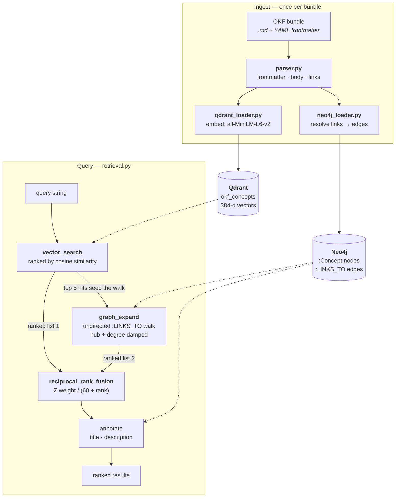

# okf-graphrag

[](https://github.com/devanshif8/okf-graphrag/actions/workflows/tests.yml)
[](LICENSE)

A consumer tool for [OKF (Open Knowledge Format)](https://github.com/GoogleCloudPlatform/knowledge-catalog/tree/main/okf) that ingests OKF bundles into a hybrid retrieval system — vector search (Qdrant) + graph traversal (Neo4j) — so agents can query OKF knowledge instead of just loading files flat into context.

## Why

OKF represents knowledge as markdown files with YAML frontmatter, cross-linked into a graph via normal markdown links. That graph structure is currently only realized visually, in the bundled viewer. `okf-graphrag` realizes it operationally: as a queryable graph combined with semantic search over concept bodies.

## How it works

Ingest runs once per bundle and writes to both stores; query fans out to both
and fuses the two rankings.



The join between the two stores is the **concept id** — `ga4/index.md`, the
path relative to the bundle root. `neo4j_loader.concept_id` mints it, Neo4j
keys its nodes on it, Qdrant carries it in each point's payload, and retrieval
fuses the two rankings by matching on it. Everything else about the two stores
is independent.

## Status

- ✅ **Parser** — extracts frontmatter, body, and links (including anchored links like `file.md#section`) from OKF concept and index files. Handles `index.md` files with no frontmatter as link-only nodes. Tested against the full `knowledge-catalog` repo (129 files) and the `ga4` sample bundle (14/14 parsed cleanly).
- ✅ **Neo4j loader** — loads parsed concepts as `:Concept` nodes and markdown links as `:LINKS_TO` edges. Idempotent (`MERGE`, not `CREATE`), so re-running updates in place, with `--prune` to remove nodes and edges that are no longer on disk. Verified against the `ga4` sample bundle: 14 nodes, 21 relationships.
- ✅ **Qdrant loader** — embeds concept bodies with `all-MiniLM-L6-v2` and upserts them into the `okf_concepts` collection. Idempotent (point ids are derived deterministically from the concept id), with `--prune` to remove points that are no longer on disk. Verified against the `ga4` sample bundle: 14 points, keyed identically to the 14 Neo4j nodes.
- ✅ **Retrieval layer** — hybrid search that fuses Qdrant vector hits with a
  Neo4j `:LINKS_TO` walk using weighted Reciprocal Rank Fusion. Plain Python, no
  LangGraph: the flow is a single linear pass (search → expand → fuse → annotate)
  with no branching or state to manage, so a graph framework would add a
  dependency without buying anything. Worth revisiting if multi-step or
  iterative retrieval lands.

## Setup

```bash
pip install -r requirements.txt
```

That is `pyyaml`, `neo4j`, `python-dotenv`, `qdrant-client` and
`sentence-transformers`. Python 3.10 or newer.

The Neo4j loader reads its connection details from environment variables, loaded
from a `.env` file in the project root (git-ignored). Copy the template and fill
it in:

```bash
cp .env.example .env
```

```
NEO4J_URI=bolt://localhost:7687
NEO4J_USER=neo4j
NEO4J_PASSWORD=your-password
```

Qdrant needs no credentials locally; set `QDRANT_URL` in the same file to point
at a server other than `http://localhost:6333`.

The Qdrant loader reads `QDRANT_URL`, defaulting to `http://localhost:6333` if
it isn't set. It needs no credentials. On first run it downloads the
`all-MiniLM-L6-v2` embedding model from the Hugging Face Hub and creates the
`okf_concepts` collection at that model's dimension.

## Usage

Parse a single file:
```bash
python parser.py path/to/concept.md
```

Parse an entire bundle:
```bash
python parser.py --bundle path/to/bundle_dir
```

Load a bundle into Neo4j:
```bash
python neo4j_loader.py path/to/bundle_dir
```

It prints how many nodes and relationships were merged, e.g.
`14 nodes merged, 21 relationships merged`. Paths are relative to the current
working directory — from the project root, the sample bundle is
`knowledge-catalog/okf/bundles/ga4`.

Re-running is safe: nodes are keyed on a bundle-relative id (`ga4/index.md`), so
a second load updates the same nodes rather than duplicating them — from any
working directory, relative path or absolute.

### Pruning deleted concepts

Loading only ever `MERGE`s, so it adds and updates but never removes. Delete or
rename a concept file, or drop a link out of one, and the node or edge it wrote
last time stays in the database — invisibly, and it keeps surfacing in search.
Pass `--prune` to reconcile the stored bundle with the parsed one:

```bash
python neo4j_loader.py path/to/bundle_dir --prune
python qdrant_loader.py path/to/bundle_dir --prune
```

Each prints what it removed on top of the usual load line, e.g.
`1 stale nodes deleted, 2 stale relationships deleted`. Deletion is scoped by
the bundle's id prefix (`ga4/`), so other bundles sharing the database or the
collection are untouched. Stale edges are removed before stale nodes, so an edge
that vanishes along with its node is still reported rather than disappearing
silently.

It is off by default because it is the one destructive operation here. As a
guard against the obvious way to lose a bundle, a prune whose parse produced no
concepts at all — a mistyped or empty bundle path — is refused rather than
deleting everything the prefix matches.

Inspect the result in Neo4j:
```cypher
MATCH (a:Concept)-[:LINKS_TO]->(b:Concept) RETURN a.path, b.path
```

Load the same bundle into Qdrant:
```bash
python qdrant_loader.py path/to/bundle_dir
```

It prints how many concepts were embedded, e.g.
`14 concepts embedded and upserted into 'okf_concepts'`. Re-running is safe for
the same reason Neo4j is: each point id is derived from the concept id, so a
second load overwrites the same points, and `--prune` drops the points whose
concept file is gone.

Each point's `path` payload field is the same bundle-relative id the Neo4j nodes
are keyed on, so a vector hit joins straight onto the graph:
```cypher
MATCH (c:Concept {path: $path_from_qdrant})-[:LINKS_TO]->(n) RETURN n.path
```

### Hybrid search

With a bundle loaded into both stores, query it:
```bash
python retrieval.py "how many users made a purchase"
```

```
1. Acquired Users Metric
   ga4/references/metrics/acquired_users.md
   rrf 0.0241  (graph #1, vector #3)
   Builds an audience of users acquired via a specific Source, Medium, and Campaign name.

2. Purchasers Audience Metric
   ga4/references/metrics/purchasers.md
   rrf 0.0239  (graph #7, vector #1)
   Computes the count or list of users who have completed a purchase or in-app purchase.
```

Each result shows its fused score and the rank it held in each list, so you can
see which signal put it there. Flags: `--top-k` (default 10),
`--vector-weight` / `--graph-weight` to rebalance the fusion (defaults 1.0 and
0.5), `--include-index` to keep hub nodes in the graph list, and
`--degree-damping` to tune how hard well-connected nodes are penalised
(default 0.5, `0` disables) — see the design notes on hub damping below.

`--top-k` sets how many results are *returned*, not how deep the search goes:
at least `MIN_CANDIDATES` (10) vector hits are always retrieved and fused, so
narrowing the output can't change the order of what's left.

The three stages are importable on their own:
```python
from retrieval import vector_search, graph_expand, hybrid_search

vector_search("purchase events", top_k=5)   # [{"id": ..., "score": ...}, ...]
graph_expand(["ga4/index.md"], hops=2)      # [{"id", "distance", "degree", "score"}, ...]
hybrid_search("purchase events")            # fused, annotated with title/description
```

## Design notes

- `index.md` files without frontmatter are treated as link-only structural nodes (`is_index: true`) rather than skipped, since they carry real graph edges.
- Link extraction matches `.md` targets, including an optional trailing anchor (`file.md#section`) — the anchor is preserved in the returned target, not stripped.
- External links (non-`.md`) are intentionally excluded from the concept graph.
- Each `:Concept` node is keyed on a **bundle-relative id** — the path relative to
  the bundle root, prefixed with the bundle directory name and normalized to
  forward slashes (`ga4/references/metrics/purchasers.md`). This id is
  independent of the working directory the loader ran from and of the host OS,
  so re-runs update nodes in place instead of duplicating them, and the same
  bundle keys identically on any machine. Downstream stores (Qdrant) should use
  this id to reference graph nodes.
- The on-disk location is kept as a separate `source_path` property. Nothing
  keys on it, so it can safely differ between machines.
- The loader stores every frontmatter field as an additional property. Values Neo4j can't store natively (nested
  dicts, mixed-type lists) are JSON-serialized; a frontmatter key named `path`
  is dropped so it can't overwrite the node id.
- Link targets are written relative to the linking file, so the loader resolves
  each one against its source directory and strips any `#anchor` before matching.
  Edges are only created when the target file is part of the same batch —
  dangling links are silently skipped rather than creating empty nodes.
- `bundle_edges` derives that edge set from the parsed concepts alone, so the
  load and the prune agree on what the bundle currently implies by construction
  rather than by two implementations happening to match.
- Bundle names come from the bundle directory's own name, so two bundles loaded
  into the same database stay distinct even though both contain `index.md`.
  Loading two *different* directories that share a basename would collide.
- Qdrant point ids must be an unsigned integer or a UUID, so they can't be the
  concept id itself. Each id is a UUIDv5 of the concept id under a fixed
  namespace — deterministic, so re-runs upsert rather than duplicate — and the
  readable id is kept in the payload as `path`.
- The embedded text is the frontmatter `description`, when present, followed by
  the body, so the one-line summary is weighted alongside the full content.
- Frontmatter is copied into the payload as-is, minus `path` and `source_path`
  so neither can overwrite the join key or the on-disk location. Dates are
  ISO-formatted and anything else non-JSON-serializable falls back to its string
  form.
- Retrieval seeds the graph walk with the top 5 vector hits rather than all of
  them; on a bundle this size, expanding from every hit reaches nearly every
  node and the graph ranking stops discriminating.
- The walk follows `:LINKS_TO` in **either** direction — a concept that links
  *to* a strong hit is as relevant as one linked *from* it.
- RRF scores each concept `sum(weight / (60 + rank))` over the lists it appears
  in. Ranks, not scores, are fused, so the cosine similarities and the hop
  counts never have to be made commensurable.
- **Hub damping.** `index.md` files carry the most `:LINKS_TO` edges, so they
  place near the top of almost any expansion regardless of the query, and the
  graph list can outvote a strong vector hit. They are therefore dropped from
  the graph list (`--include-index` restores them). The walk still routes
  *through* them, so concepts connected only via an index stay neighbours.
  Identification is by id suffix rather than the parser's `is_index` flag: that
  flag sits outside the frontmatter, so `neo4j_loader` never stores it. The
  practical difference is that an `index.md` *with* frontmatter parses as an
  ordinary concept but is still treated as a hub here — acceptable, since
  hub-ness follows from the file's role in the tree either way. Persisting
  `is_index` as a node property would make the test exact.
- **Degree scaling.** Beyond index files, any well-connected concept is
  reachable from more seeds whatever the query. Each neighbour therefore scores
  `seeds_hit / (distance * degree ** damping)`, with `--degree-damping`
  defaulting to 0.5 — the square root, the usual middle ground between ignoring
  degree and dividing it out entirely. It measurably does its job: on the ga4
  bundle `tables/events_.md` (degree 9) drops out of the top of the graph list
  that it otherwise leads.
- **Residual limitation — structurally indistinguishable leaves.** Neither
  damping lever changes the top of "how many users made a purchase":
  `purchasers.md` (vector #1, 0.494) still fuses to #2 behind
  `acquired_users.md` by 0.0002. The reason is not bias but an absence of
  signal — every leaf metric in the bundle has degree 2 and sits one hop from a
  seed, so all seven score *identically* (0.7071) and the tie falls to the id,
  alphabetically, which puts `purchasers.md` 7th. RRF then treats that
  alphabetical accident as evidence. On a bundle whose leaves are this uniform,
  the graph list simply has nothing query-specific to say about them, and no
  weighting of a meaningless order will fix that. The fix that would: break
  graph ties by the neighbour's own vector rank, so structure defers to
  semantics exactly where structure is silent.

## Development

Install the runtime dependencies plus the test runner:

```bash
pip install -r requirements-dev.txt
```

Run the test suite from the repo root:

```bash
pytest
```

`pyproject.toml` puts the repo root on `sys.path` and points pytest at
`tests/`, so this works with no install step. The suite covers the pure logic
in all four modules — parsing, id derivation, property and payload coercion,
and rank fusion — and needs no Neo4j, no Qdrant and no model download, so it
runs offline in a couple of seconds. Anything that talks to a service is
verified by hand against the `ga4` sample bundle instead; see Status above.

CI runs the same command on every push and pull request across Python
3.10-3.13 (`.github/workflows/tests.yml`).

See [CONTRIBUTING.md](CONTRIBUTING.md) for how to verify the service-backed
code paths by hand, the code style to match, and how to open a pull request.

## License

Apache 2.0 — see [LICENSE](LICENSE).
